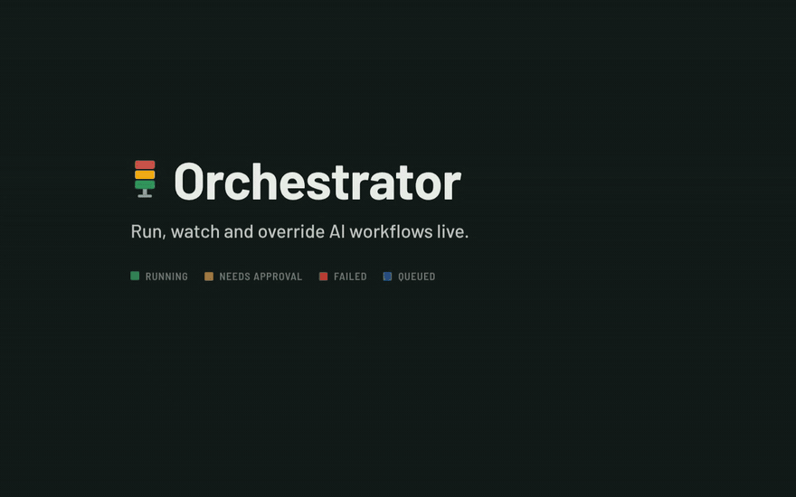
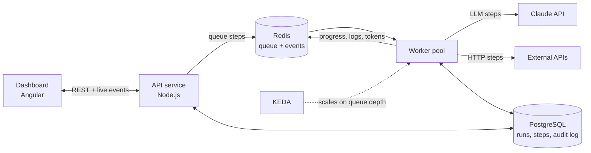

# Orchestrator

**A live control room for AI workflows.** Chain Claude prompts, API calls and human sign-offs
into one workflow. Watch every run move across a pool of workers in real time, and step in at
any point.

[](https://github.com/hassanzafarr/AI-workflow-orchestration/actions/workflows/ci.yml)


[](docs/media/orchestrator-demo.mp4)

<sub>A one-minute narrated walkthrough recorded from the running app. [Watch the full video with sound](docs/media/orchestrator-demo.mp4).</sub>


https://github.com/user-attachments/assets/6ebfd659-aa8d-43cc-aae3-5ec5e278dd2c


## The problem it solves

Teams are putting AI into real business processes: researching a lead, drafting an article,
triaging support tickets, enriching thousands of records. One prompt is rarely enough. These
processes need several steps that depend on each other, retries when a call fails, a person to
approve before anything goes out, and enough capacity to absorb a sudden spike of work.

Orchestrator runs those processes and gives operators one screen to see what is happening and
take control of it.

## What you can do with it

- **Build workflows from steps.** Mix Claude prompts, HTTP calls, data transforms, timed waits
  and human approvals. Or describe what you want in plain English and let Claude draft the
  workflow for you.
- **Watch runs live.** Each step lights up as it starts. Claude's output streams in word by word,
  and steps that don't depend on each other run in parallel.
- **Stay in control.** Pause, cancel or retry a run. Retry or skip a single step. Approve or
  reject at human checkpoints, or stop all execution with one button during an incident. Every
  action is recorded in an audit log with the operator's name.
- **Understand failures.** "Ask Claude why" reads a failed step's configuration and logs and
  explains what went wrong.
- **Scale with demand.** Work spreads across a pool of workers. On Kubernetes the pool grows as the
  queue fills and shrinks once it drains.

## Engineering highlights

- **Crash-safe by design.** Every state change is a locked database transaction, so any number of
  API servers and workers can drive the same run safely, and stale work from before a pause or
  retry is recognised and dropped. If a worker dies mid-task, the work is detected and picked up
  again elsewhere.
- **Real-time from end to end.** A WebSocket event stream drives the whole dashboard, including
  Claude's tokens streamed from the API to the browser as they are generated.
- **Autoscaling that is safe to shrink.** Workers scale on queue depth (KEDA on Kubernetes) and
  finish their in-flight steps before shutting down.
- **Human-in-the-loop built in.** Approval is a step type of its own: the run waits for a person,
  and their decision and comment go into the audit log.
- **Runs without an API key.** A mock mode produces realistic, streamed output, so the platform
  can be demoed and load-tested for free. The demo above was recorded this way.
- **Tested and shipped like production code.** It has unit tests, integration tests against real
  Postgres and Redis, and an end-to-end smoke test. CI builds the Docker images and validates the
  Kubernetes manifests on every push.

## How it works



The dashboard talks to a stateless API service. When a run starts, the API queues every step
that is ready, and workers pick them up in parallel. Workers report progress back as it happens,
so the dashboard always shows the current state. PostgreSQL is the source of truth. The API and
the workers are separate services built from the same code, so each scales on its own.

For the full architecture, execution model, configuration and Kubernetes deployment, see the
**[technical documentation](docs/TECHNICAL.md)**.

## Built with

| Area | Technology |
|---|---|
| Frontend | Angular 21 (standalone components, signals), TypeScript |
| Backend | Node.js 22, Express 5, WebSocket |
| Jobs and queue | BullMQ on Redis |
| Database | PostgreSQL |
| AI | Claude API via the Anthropic SDK, with streaming and structured outputs |
| Infrastructure | Docker, Kubernetes, KEDA autoscaling, GitHub Actions CI |

## Try it locally

You need Node.js 22 and Docker.

```bash
npm install
npm run setup   # install the backend and dashboard dependencies
npm run infra   # start PostgreSQL and Redis in Docker
npm run dev     # start the API, a worker and the dashboard
```

Open http://localhost:4200. Four demo workflows are ready to run. The app starts in mock mode;
set `ANTHROPIC_API_KEY` to call the real Claude API.

Prefer containers? Run `docker compose up --build --scale worker=3` and open http://localhost:8080.

## Project structure

```
backend/   API and worker services: workflow engine, queue, Claude integration
web/       Angular dashboard
deploy/    Kubernetes manifests (Kustomize, KEDA autoscaling)
scripts/   end-to-end smoke test and load generator
docs/      technical documentation and demo media
```

The dashboard's design system is documented in [DESIGN.md](DESIGN.md).

## Author

Built by **Hassan Zafar**. [Portfolio](https://hassan-zafar-portfolio.vercel.app) ·
[GitHub](https://github.com/hassanzafarr)
